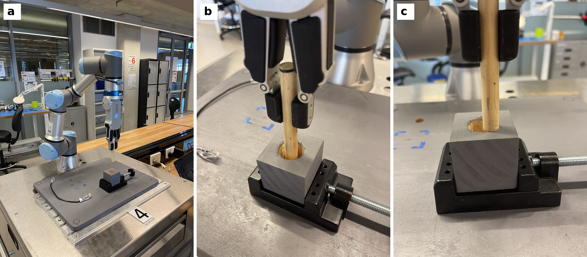
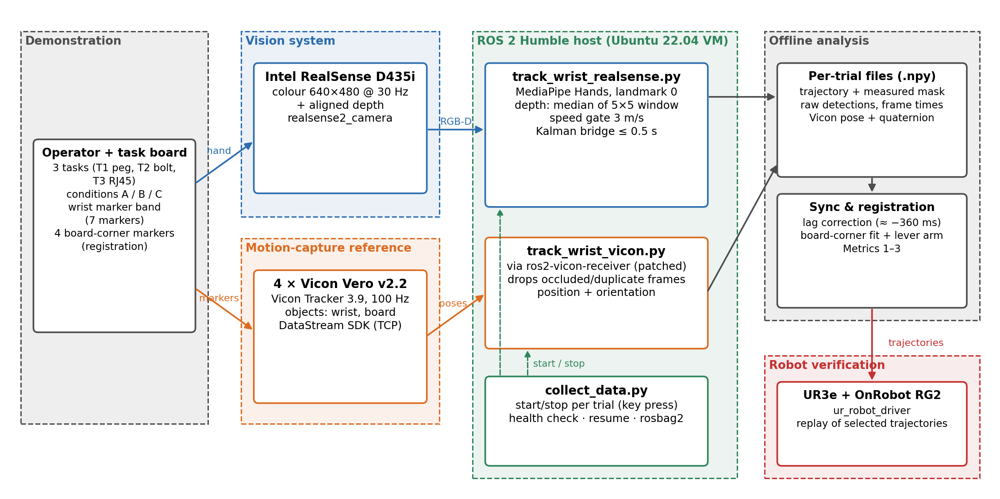

# Vision-Based Learning from Demonstration vs Motion Capture

[](https://docs.ros.org/en/humble/)
[](https://www.python.org/)
[](https://releases.ubuntu.com/22.04/)
[](https://ai.google.dev/edge/mediapipe/solutions/vision/hand_landmarker)
[](https://www.intelrealsense.com/depth-camera-d435i/)
[](https://www.universal-robots.com/products/ur3e/)
[](LICENSE)

Can a single RGB-D camera replace marker-based motion capture for recording human demonstrations
of industrial assembly tasks? This repository contains the software and processed data of a
University of Technology Sydney engineering capstone (2026) that answers this question
experimentally.

A RealSense D435i with MediaPipe wrist tracking and aligned depth was compared with a Vicon
system on three assembly tasks (peg-in-hole, bolt tightening, RJ45 connector) under standard
light, reduced light and partial occlusion. 325 demonstrations were recorded, 200 of them by both
systems simultaneously, and ten demonstrations were replayed on a UR3e robot from each system.

<p align="center">
  
  <br><em>Robot replay of a demonstrated peg insertion: set-up (a), path from Vicon (b), path from the camera (c).</em>
</p>

## Results

| | RealSense D435i + MediaPipe | Vicon (reference) |
|---|---|---|
| **Accuracy** (wrist, against Vicon) | 13–16 mm RMSE; 7.7–19.8 mm at the insertion point | sub-millimetre |
| **Robustness** (demonstrations captured) | 100% in reduced light; 95–100% with fingertips hidden; 0–45% when the other hand covers the wrist | – |
| **Usability** (setup to first recording) | under 5 min, no calibration | 17–80 min, recalibration after camera faults |
| **Robot replay**, peg with 5.5 mm clearance | 4/10 inserted | 10/10 inserted |

The camera error is largely systematic: it grows with wrist rotation, and at the insertion point
it is mostly a constant offset towards the camera. Even perfect wrist tracking was not enough for
the final millimetres, because the part sat differently in the hand in each demonstration.

## System

<p align="center">
  
</p>

- **Vision pipeline:** MediaPipe Hands (landmark 0) with depth from the aligned depth image,
  a speed gate and a constant-velocity Kalman filter for short gaps.
- **Reference:** four Vicon Vero cameras (Tracker 3.9, 100 Hz) streamed into ROS 2 with
  [ros2-vicon-receiver](https://github.com/OPT4SMART/ros2-vicon-receiver).
- **Registration:** camera and Vicon aligned through markers on the task-board corners,
  independently of the tracker under test.
- **Robot replay:** demonstrated paths transferred to a UR3e through the same board corners,
  checked in RViz, then executed with a force-guarded insertion using
  [ur_rtde](https://sdurobotics.gitlab.io/ur_rtde/).

## Repository structure

```
scripts/            ROS 2 tracking nodes, data collection, analysis, figures, robot replay, tests
data/               processed RealSense and Vicon recordings, calibration takes, robot results
docs/report/        figures, generated result tables, Vicon driver patch
```

| Script | Purpose |
|---|---|
| `track_wrist_realsense.py` | RealSense wrist tracker (MediaPipe, depth, Kalman) |
| `track_wrist_vicon.py` | Vicon wrist recorder |
| `collect_data.py` | Runs blocks of trials with health checks |
| `analyze_results.py` | Accuracy, robustness and usability analysis; result tables and figures |
| `robot_replay.py` | Touch-based board registration, planning, RViz simulation, robot execution |

## Getting started

Requirements: Ubuntu 22.04, ROS 2 Humble, Python 3.10.

```bash
git clone https://github.com/ntmq-j/LfD-Capstone.git && cd LfD-Capstone
python3 -m venv venv && venv/bin/pip install -r requirements-venv.lock

venv/bin/python scripts/analyze_results.py --selftest
venv/bin/python scripts/analyze_results.py        # docs/report/results/ and figures
venv/bin/python scripts/robot_replay.py report    # robot replay table and figure
```

The analysis runs from the processed data in `data/`. Raw rosbags with colour and depth images
(about 7 GB) are not included.

## License

Code is released under the [MIT License](LICENSE). Data and figures are released under
[CC BY 4.0](https://creativecommons.org/licenses/by/4.0/). The Vicon driver patch in
`docs/report/appendix/` modifies GPL-3.0 software and is distributed under GPL-3.0.
